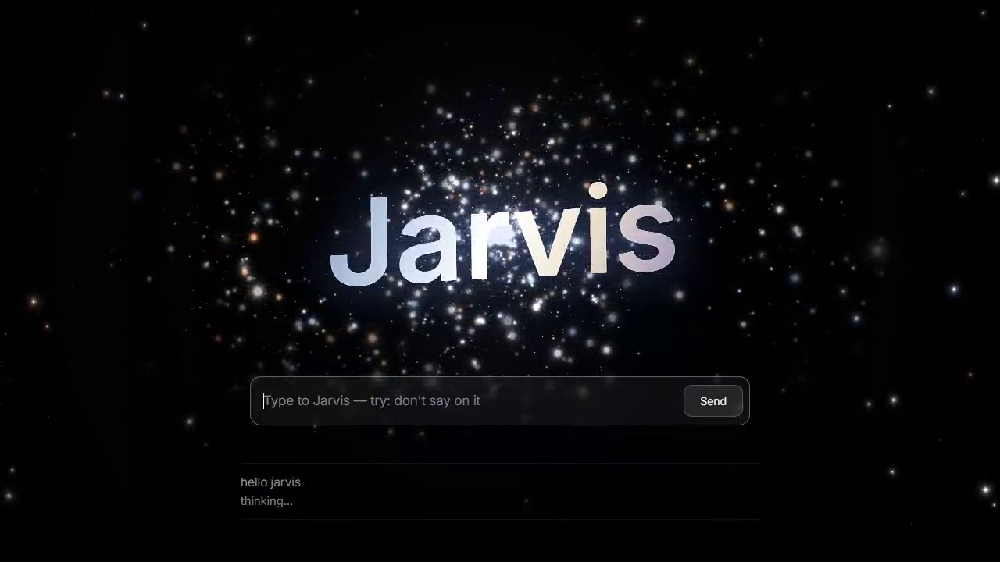
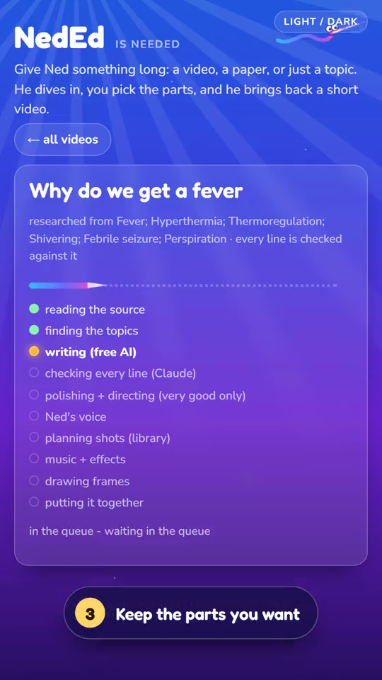

# Arnav's projects

I build the tools I keep wishing I had: file tools that run locally, sound tuning for my existing headphones, a way to see where my Claude usage went, and an assistant that keeps up with my coding sessions.

**[Open my website](https://arnav-agarwal137.github.io/) · [GitHub profile](https://github.com/Arnav-Agarwal137) · [LinkedIn](https://www.linkedin.com/in/arnav-agarwal-623526436/)**

## Pick something to try

| Project | The problem I built it for | Start here |
|---|---|---|
| **Bill Wall** | Finding a competition early enough to prepare | [Open the wall](https://arnav-agarwal137.github.io/competition-radar/bills/) · [How it works](https://github.com/Arnav-Agarwal137/competition-radar#the-bill-wall) |
| **Pass Wall** | Hearing about fellowships, workshops and research communities in time | [Open the wall](https://arnav-agarwal137.github.io/competition-radar/passes/) · [How it works](https://github.com/Arnav-Agarwal137/competition-radar#the-pass-wall) |
| **LocalDoc Kit / Filer** | Fixing files without uploading them to another converter | [Use it](https://arnav-agarwal137.github.io/localdoc-kit/) · [Read the project](https://github.com/Arnav-Agarwal137/localdoc-kit) |
| **Audito Amplificus** | Getting more from my headphones without adjusting every song by hand | [Android APK](https://github.com/Arnav-Agarwal137/audito-amplificus/releases/tag/v0.1.17) · [Read the project](https://github.com/Arnav-Agarwal137/audito-amplificus) |
| **Virus Vigil** | Understanding security warnings and the next step to take | [Source and build guide](https://github.com/Arnav-Agarwal137/virus-vigil) |
| **Promter** | Seeing where a Claude plan goes while I work | [Install the plugin](https://github.com/Arnav-Agarwal137/promter#install-in-claude-code) |

## Watch the private builds

These two have public demonstrations, not public source or installers.

| Jarvis | NedEd |
|---|---|
|  |  |
| An assistant that tells me what my coding sessions are doing. [Watch](https://arnav-agarwal137.github.io/videos/jarvis-demo.mp4) · [Project notes](docs/jarvis.md) | A topic, paper or video becomes a narrated explainer. [Watch](https://arnav-agarwal137.github.io/videos/neded-demo.mp4) · [Project notes](docs/neded.md) |

## Other things on the shelf

[Scar Tissue](https://github.com/Arnav-Agarwal137/scar-tissue), [Sentinel Gujarat](https://github.com/Arnav-Agarwal137/sentinel-gujarat), [Working Papers](https://github.com/Arnav-Agarwal137/working-papers), [NEET counselling tools](https://github.com/Arnav-Agarwal137/neet-counselling) and [KCET College Finder](https://github.com/Arnav-Agarwal137/kcet-college-finder).

## About this repository

`index.html` is the personal website served through GitHub Pages. `videos/` holds the existing public demos. `docs/` holds project notes and screenshots. Jarvis and NedEd source, credentials and personal working data are not published by this repository.

Each software project has its own licence and privacy terms in its repository. A screenshot or demo link is not a software licence grant.
