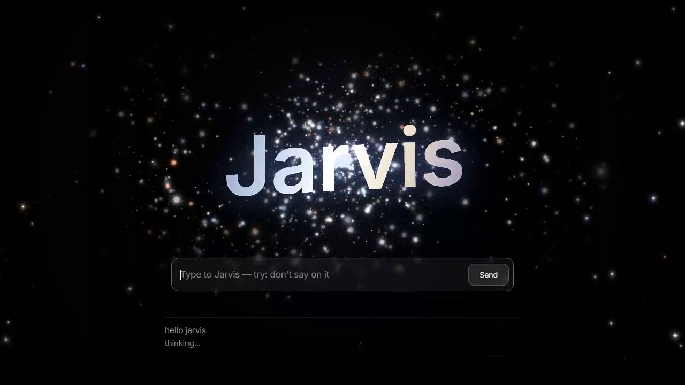

# Jarvis

## Ask the laptop what is happening instead of opening every terminal.

I use several Claude Code sessions at once. The problem is keeping up with them when I am away from the keyboard: which one is working, which is stuck, and which one needs an answer from me?

Jarvis is the voice assistant I built around that problem. It reads session state, gathers what is waiting, and answers out loud and in writing.

**[Watch the 64-second demo](https://arnav-agarwal137.github.io/videos/jarvis-demo.mp4) · [Back to my projects](../README.md)**

## What you see in the demo

The page greets Jarvis, asks what is going on, and asks for the weather. Replies come from the running assistant. Waiting time was trimmed in the edit; this is a demonstration, not a latency benchmark.

## What I use it for

- Hear which coding sessions are working, stuck or waiting on me.
- Ask a session a question without switching between terminals.
- Gather reminders and things that need my attention.
- Open a project or hand a larger job to a coding session through its tool system.

I can talk through a hotkey or use the page. Voice input, session inspection, a task/router layer and spoken replies connect the assistant to work already running on my laptop.

The project record at the time of recording counted **538 commits since 5 September 2026**. That is a dated development snapshot, not a live counter or a claim about how many people use it.

## Why there is a video instead of a download

This is my personal running system. Its environment includes private session data, credentials and integrations that do not belong in a public release. **There is no public Jarvis source or installer offered here.** This page publishes the demonstration and project description only.

The assistant's safety rules distinguish reading information from taking action, but this demo is not a general security audit. I am showing the workflow I built, not offering unattended control of somebody else's laptop.

Built by [Arnav Agarwal](https://github.com/Arnav-Agarwal137).
