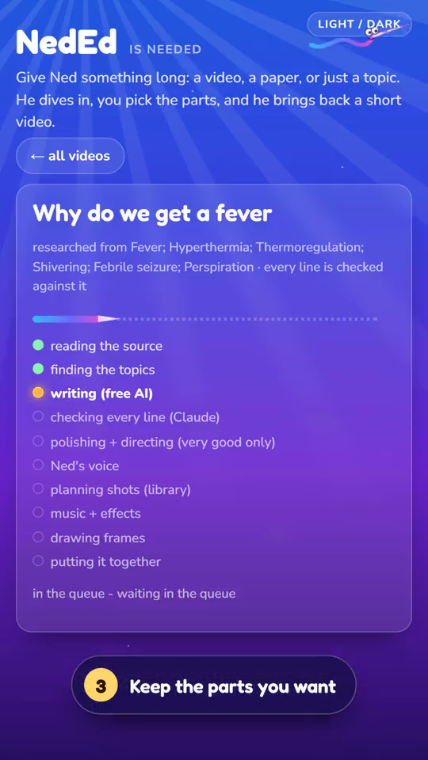
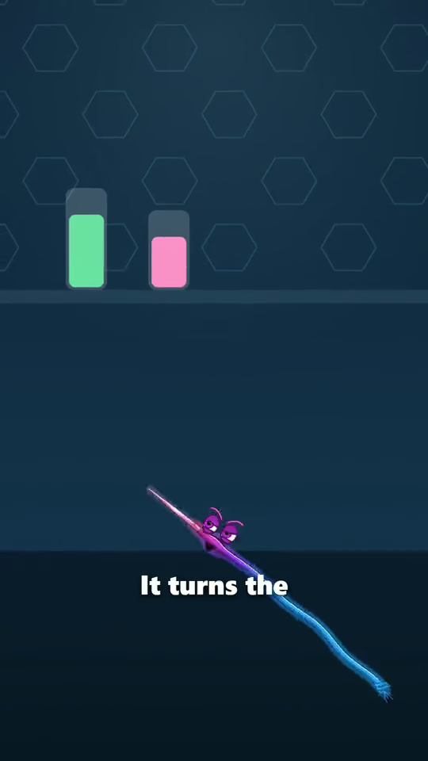

# NedEd

## Give Ned something long. Pick the parts worth keeping.

Sometimes I want the explanation from a paper or a long video without turning the whole thing into another reading assignment. I also want to choose which parts make it into the result.

NedEd takes a topic, paper or video, builds an outline, lets me choose sections, and turns them into a narrated explainer with Ned the Needle.

**[Watch the 67-second demo](https://arnav-agarwal137.github.io/videos/neded-demo.mp4) · [Back to my projects](../README.md)**

 

## The workflow

1. Give the app a topic, paper or video.
2. Let it read the source and suggest sections.
3. Keep the parts you want explained.
4. Generate the script, narration, scenes, captions, music and final video.
5. Watch the result and decide what needs editing.

For a general topic, the pipeline researches sources. For a supplied video, the design is to work from that source rather than quietly mixing in outside claims. Script checking is a separate step before narration and rendering.

## A little of what is under the surface

NedEd connects source processing, AI-assisted writing and checking, voice generation, scene rendering and video assembly. The demo uses Kokoro narration. Ned, the props, movement, sound effects and music are directed around the explanation instead of placing a paragraph on a static background.

The demo is edited and includes a generated example. Its running time is not the generation time. Fact checking can still miss an error; an explainer is not medical advice or a substitute for the original source.

## Can I try it?

**This is a demo of a private build. There is no public app, source-code release or installer here.** Public material is the video and these project notes. The owner's publishing studio is separate from the explanation workflow shown.

Music credit carried with the public demo: Kevin MacLeod, [CC BY 4.0](https://creativecommons.org/licenses/by/4.0/). Music is edited/mixed into the video; its licence does not license NedEd's software.

Built by [Arnav Agarwal](https://github.com/Arnav-Agarwal137).
